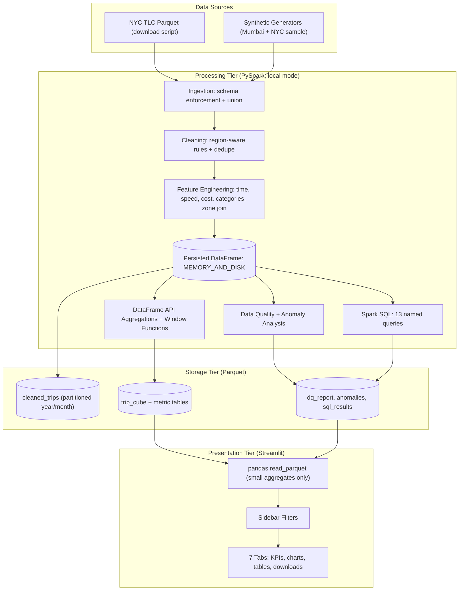
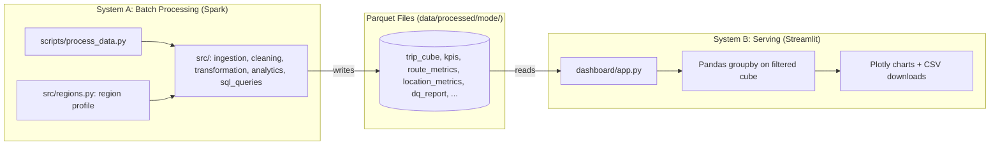
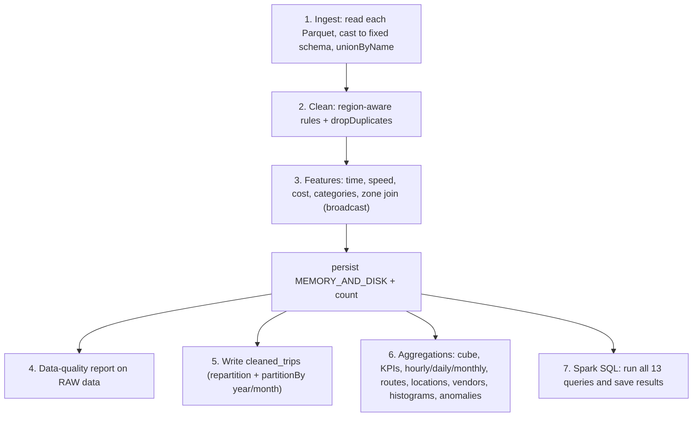

<div align="center">

# 🚕 Taxi Trip Big Data Analytics & Intelligence Dashboard
### *Large-Scale Taxi Trip Analysis Using PySpark, Apache Spark SQL and Streamlit*

[](https://www.python.org/)
[](https://spark.apache.org/)
[](https://spark.apache.org/docs/latest/api/python/)
[](https://parquet.apache.org/)
[](https://streamlit.io/)
[](https://plotly.com/python/)
[](https://adoptium.net/)

<p align="center">
  <b>Turn millions of raw taxi trip records into clean, aggregated, explorable analytics.</b><br/>
  A PySpark pipeline ingests, cleans, enriches and aggregates trip data into Parquet, and a filterable Streamlit dashboard
  answers questions about demand, revenue, fares, tips, routes, vendors and data quality.
</p>

[Key Features](#3-key-features) • [Architecture](#4-system-architecture) • [Datasets & Regions](#6-datasets--region-profiles) • [Pipeline](#7-pyspark-pipeline) • [Spark SQL](#10-spark-sql--window-functions) • [Dashboard](#12-streamlit-dashboard) • [Setup](#15-installation--setup) • [Troubleshooting](#19-troubleshooting)

</div>

---

## 📋 Table of Contents

- [1. Executive Summary](#1-executive-summary)
- [2. Problem Statement](#2-problem-statement)
- [3. Key Features](#3-key-features)
- [4. System Architecture](#4-system-architecture)
- [5. Dual System Map](#5-dual-system-map)
- [6. Datasets & Region Profiles](#6-datasets--region-profiles)
- [7. PySpark Pipeline](#7-pyspark-pipeline)
- [8. Data Cleaning Rules](#8-data-cleaning-rules)
- [9. Feature Engineering & Processed Outputs](#9-feature-engineering--processed-outputs)
- [10. Spark SQL & Window Functions](#10-spark-sql--window-functions)
- [11. Performance Optimizations](#11-performance-optimizations)
- [12. Streamlit Dashboard](#12-streamlit-dashboard)
- [13. Business Questions Answered](#13-business-questions-answered)
- [14. Technology Stack](#14-technology-stack)
- [15. Installation & Setup](#15-installation--setup)
- [16. Configuration](#16-configuration)
- [17. Running the Project](#17-running-the-project)
- [18. Project Structure](#18-project-structure)
- [19. Troubleshooting](#19-troubleshooting)
- [20. Known Limitations](#20-known-limitations)
- [21. Future Roadmap](#21-future-roadmap)

---

## 1. Executive Summary

**Taxi Trip Big Data Analytics** is an end-to-end data engineering and analytics project built around **Apache Spark**. Instead of loading trip records into Pandas, every heavy step (ingestion, cleaning, feature engineering, aggregation, SQL analysis) runs in **PySpark**, and the results are written as Parquet. A **Streamlit** dashboard then reads only the small pre-aggregated outputs, so it stays fast no matter how large the raw data is.

```
Raw Parquet ──▶ PySpark Ingestion ──▶ Cleaning ──▶ Feature Engineering ──▶ Spark SQL + Aggregations ──▶ Parquet ──▶ Streamlit
```

The project ships with three data modes that share one pipeline:

| Mode | Data | Units | Purpose |
| :--- | :--- | :--- | :--- |
| `mumbai` | Synthetic Mumbai taxi trips (100,500 rows by default) | ₹ / km | Mumbai-based demo, scalable with `--rows` |
| `sample` | Synthetic 20,100-row sample in the NYC TLC schema | USD / miles (shown as ₹ / km) | Instant test, no download |
| `full` | Real NYC TLC Yellow Taxi monthly files | USD / miles (shown as ₹ / km) | Multi-million-row processing |

> [!IMPORTANT]
> The `mumbai` and `sample` datasets are **synthetic**. They exist to exercise the pipeline and dashboard. Do not quote their numbers as real-world findings. Only `full` mode (real NYC TLC data) produces real insights.

---

## 2. Problem Statement

Taxi operators, city planners and analysts need to understand demand and revenue patterns, but raw trip logs are large and messy.

| Challenge | Naive Approach (Pandas / Excel) | This Project |
| :--- | :--- | :--- |
| **Scale** | Loads everything into memory; fails beyond a few million rows. | **Spark** does the heavy work and writes partitioned Parquet; the dashboard never touches raw rows. |
| **Dirty data** | Silently drops rows or ignores errors. | **Documented, domain-based cleaning rules** plus a data-quality report showing exactly what was removed and why. |
| **Schema drift** | Monthly files differ in column types and break unions. | **Explicit schema enforcement**: every file is cast to one fixed schema before union. |
| **Interactive exploration** | Static charts, one-off notebooks. | **Pre-aggregated cube** powering 7 tabs, multiple filters and CSV downloads. |
| **Region differences** | Hard-coded thresholds in dollars and miles. | **Region profiles** hold units, limits, labels and vendor names per region. |

---

## 3. Key Features

* **Spark-First Processing**: Ingestion, cleaning, features, aggregations and window functions all run in PySpark. Pandas is only used on small aggregates inside the dashboard.
* **Schema-Safe Ingestion**: Each Parquet file is read separately, matched to the expected columns case-insensitively, cast to fixed types and combined with `unionByName`. Missing optional columns become null.
* **Documented Cleaning**: Every rule has a stated reason (see [Section 8](#8-data-cleaning-rules)). Fixable fields are imputed rather than deleted.
* **Data-Quality Report**: Counts of missing values, duplicates, invalid distances, fares, dates, durations, passenger counts and outliers, saved as Parquet and shown in the dashboard.
* **13 Spark SQL Queries**: Kept in separate `.sql` files and using CTEs, `HAVING`, `CASE WHEN`, date functions and window functions (`RANK`, `LAG`, moving averages).
* **Window Functions in DataFrame API and SQL**: Route ranking, monthly vendor ranking, month-over-month growth and 7-day moving averages.
* **Region Profiles**: One pipeline handles NYC (miles / USD) and Mumbai (km / INR) through a single configuration module.
* **Rule-Based Anomaly Analysis**: Flags trips with extreme distance, fare, duration or fare-per-distance using a z-score threshold, with no machine learning.
* **Interactive Dashboard**: 7 tabs, KPI cards, sidebar filters, Plotly charts, expanders and CSV download buttons.
* **Friendly Error Handling**: Missing data, empty results, bad paths and Spark startup failures produce readable messages rather than raw stack traces.

---

## 4. System Architecture



---

## 5. Dual System Map

The project is two systems that communicate **only through Parquet files**. The dashboard never starts Spark.



### Why a pre-aggregated "cube"?

Filters must feel instant, but re-running Spark on every click is slow and loading millions of rows into Pandas defeats the purpose. Spark therefore groups trips by **date × hour × vendor × payment type × distance category × passenger count** and stores only **additive sums** (trips, revenue, fare, distance, duration, tips). The dashboard filters this small table and **recomputes averages from the sums** (for example, average fare = fare sum ÷ trips), which keeps every number correct after filtering.

> Zone filters apply to the Locations tab only, because adding pickup and drop-off zones to the cube would make it enormous.

---

## 6. Datasets & Region Profiles

### Data modes

| Command | Input | Output folder |
| :--- | :--- | :--- |
| `process_data.py --mode mumbai` | `data/sample/mumbai_taxi_sample.parquet` | `data/processed/mumbai/` |
| `process_data.py --mode sample` | `data/sample/taxi_sample.parquet` | `data/processed/sample/` |
| `process_data.py --mode full` | `data/raw/*.parquet` | `data/processed/full/` |

### Real data source

NYC TLC Yellow Taxi Trip Records: <https://www.nyc.gov/site/tlc/about/tlc-trip-record-data.page>. The download script fetches monthly Parquet files and the taxi-zone lookup table. Raw data is **not** committed to Git.

### Synthetic Mumbai data

No public, trip-level Mumbai taxi dataset exists in this schema, so `scripts/generate_mumbai_data.py` simulates one:

* **33 real Mumbai localities** (Bandra West, Andheri East, BKC, Lower Parel, Dadar, Thane, Vashi, both airport terminals, and more) with approximate coordinates.
* **Distances** from haversine distance × a road factor, using a **distance-decay (gravity) model** so most trips stay local.
* **Vendors**: Kaali-Peeli (black and yellow) metered taxis, plus Ola, Uber and Meru app cabs with peak-hour surge.
* **Traffic and demand**: morning and evening peaks with slower speeds, night surcharges, tolls and airport fees.
* **Payments**: digital (UPI/card), cash, wallet.
* **Dirty rows** (about 3 percent): negative fares, zero distances, drop-off before pickup, missing passenger counts, duplicates and extreme values, so the cleaning step has real work to do.

> [!NOTE]
> Fare parameters are **illustrative, not official tariffs**.

### Region profiles (`src/regions.py`)

Everything that differs between regions lives in one dataclass.

| Setting | NYC profile | Mumbai profile |
| :--- | :--- | :--- |
| Currency / distance unit | USD / miles | INR / km |
| Distance categories | 0-2, 2-5, 5-10, 10-20, 20+ miles | 0-3, 3-8, 8-16, 16-32, 32+ km |
| Max distance | 100 miles | 150 km |
| Max fare / max total | $500 / $1,000 | ₹10,000 / ₹15,000 |
| Max speed | 80 mph | 100 km/h |
| Max duration | 180 min | 240 min |
| Vendors | Creative Mobile Technologies, VeriFone / Curb Mobility, Myle, Helix | Kaali-Peeli, Ola, Uber, Meru |
| Payments | Credit card, Cash, No charge, Dispute, Flex, Unknown, Voided | Digital (UPI/Card), Cash, Wallet, Dispute, Unknown |
| Zone lookup | TLC `taxi_zone_lookup.csv` | `mumbai_zone_lookup.csv` |

### Data dictionary (core columns)

| Column | Meaning |
| :--- | :--- |
| `VendorID` | Technology provider / operator code |
| `tpep_pickup_datetime` / `tpep_dropoff_datetime` | Trip start and end timestamps |
| `passenger_count` | Passengers (often missing or zero in raw data) |
| `trip_distance` | Distance in the region's unit |
| `PULocationID` / `DOLocationID` | Pickup and drop-off zone IDs |
| `payment_type` | Payment code (mapped to names per region) |
| `fare_amount`, `extra`, `tip_amount`, `tolls_amount`, `airport_fee`, `total_amount` | Charge components |

Full column and engineered-feature descriptions are in [`docs/data_dictionary.md`](./docs/data_dictionary.md).

---

## 7. PySpark Pipeline

The only entry point for Spark is `scripts/process_data.py`.



| Step | Module | What happens |
| :--- | :--- | :--- |
| Session | `src/spark_session.py` | Local `SparkSession`; sets `PYSPARK_PYTHON` to the venv interpreter; on Windows configures `HADOOP_HOME` for `winutils.exe`. |
| Ingest | `src/ingestion.py` | Fixed schema, case-insensitive column matching, null fill for missing optional columns, required-column validation. |
| Clean | `src/cleaning.py` | Region-aware validity filters, imputation, deduplication, quality report. |
| Features | `src/transformation.py` | Time, speed, cost and category columns; broadcast join with zone names. |
| Aggregate | `src/analytics.py` | Cube, KPIs, routes, locations, vendor ranking, histograms, scatter sample, anomalies. |
| SQL | `src/sql_queries.py` | Parses `-- name:` blocks from `sql/*.sql` and runs them against the `taxi_trips` view. |

Useful flags:

```bash
python scripts/process_data.py --mode mumbai --explain   # print the Spark execution plan
python scripts/process_data.py --mode full --input path  # override the input path
```

---

## 8. Data Cleaning Rules

Rules are **domain-based**, not blind statistical outlier removal. Thresholds come from the region profile.

| Rule | Reason |
| :--- | :--- |
| Drop rows with null pickup/drop-off time, distance, fare, total or zones | These fields cannot be guessed and every metric depends on them. |
| `passenger_count` null or 0 → **1** | Driver-entered field; the trip and its revenue are valid, so impute instead of deleting. |
| Null `payment_type` → **Unknown (5)** | Keeps the revenue; shown as its own category. |
| Pickup date must be 2015 to 2030 | Raw TLC files contain stray rows with dates like 2002 or 2098. |
| Duration between 1 minute and the region maximum; drop-off after pickup | Removes zero or negative durations and meters left running. |
| Distance greater than 0 and within the region maximum | Zero means a glitch or cancelled trip; extreme values are not city taxi trips. |
| Fare and total greater than 0 and within the region maximum | Negative amounts are refunds or adjustments; huge amounts are entry errors. |
| Passenger count at most 6 | Vehicle capacity. |
| Speed within the region maximum | Physically implausible speeds indicate bad timestamps or distances. |
| Drop exact duplicates on 8 key columns | Repeated records inflate revenue. |

The data-quality report is computed on the **raw** data and includes: `total_rows`, `missing_*` per key column, `duplicate_rows`, `invalid_distance`, `invalid_fare`, `invalid_dates`, `invalid_duration`, `invalid_passenger_count`, `outlier_fare`, `outlier_distance`, `outlier_speed`, `rows_after_cleaning` and `rows_removed`.

The anomaly step runs **after** cleaning and only **reports** trips where the absolute z-score exceeds 4 for distance, fare, duration or fare-per-distance. It never deletes rows.

---

## 9. Feature Engineering & Processed Outputs

### Engineered columns

| Group | Columns |
| :--- | :--- |
| Time | `pickup_date`, `pickup_year`, `pickup_month`, `pickup_day`, `pickup_day_of_week`, `pickup_hour`, `is_weekend`, `time_period` (Morning / Afternoon / Evening / Night) |
| Trip metrics | `trip_duration_minutes`, `average_speed_mph`, `fare_per_mile`, `total_cost_per_mile`, `tip_percentage` |
| Categories | `trip_distance_category`, `fare_category`, `passenger_category` (Solo / Pair / Group) |
| Labels | `vendor_name`, `payment_name`, `pickup_zone`, `dropoff_zone` |

> Column names such as `average_speed_mph` and `fare_per_mile` are kept for schema consistency. In Mumbai mode they hold km/h and per-km values.

### Output tables (`data/processed/<mode>/`)

| Folder | Content |
| :--- | :--- |
| `cleaned_trips/` | Full cleaned and enriched table, **partitioned by year and month**. |
| `trip_cube/` | Small pre-aggregate that powers every dashboard filter. |
| `kpis/` | Overall KPIs including the approximate median distance. |
| `hourly_metrics/`, `daily_metrics/`, `monthly_metrics/` | Time-based metrics. |
| `route_metrics/` | Per-route stats with `RANK()` by trips and by revenue. |
| `location_metrics/` | Pickup and drop-off zones stacked with a `role` column. |
| `vendor_monthly/` | Monthly vendor revenue ranked within each month. |
| `distance_hist/`, `duration_hist/`, `scatter_sample/` | Chart data (the scatter sample holds about 5,000 trips). |
| `dq_report/`, `anomaly_summary/`, `anomaly_sample/` | Data quality and anomaly results. |
| `sql_results/<query>/` | Output of every Spark SQL query. |

> Tip percentage is calculated on **digital/card payments only**, because cash tips are not recorded.

---

## 10. Spark SQL & Window Functions

Queries live in `sql/*.sql`. Each block begins with `-- name: query_name` and is loaded by `src/sql_queries.py`, which registers the `taxi_trips` temp view.

| File | Query | Concepts |
| :--- | :--- | :--- |
| `trip_analysis.sql` | `busiest_hours` | `GROUP BY`, `HAVING`, `ORDER BY` |
| | `weekday_vs_weekend` | `CASE WHEN` |
| | `peak_hour_share` | CTE + `RANK() OVER` |
| | `distance_category_summary` | Aggregation by category |
| `revenue_analysis.sql` | `daily_revenue_moving_avg` | Window frame: 7-day moving average |
| | `monthly_revenue_growth` | Date functions + `LAG()` |
| | `payment_summary` | Aggregation |
| | `tip_by_time_period` | Filtered aggregation (digital payments) |
| `route_analysis.sql` | `top_routes_by_revenue` | CTE + `RANK()` |
| | `busiest_pickup_zones` | Window over an aggregate (`SUM(COUNT(*)) OVER ()`) |
| | `highest_fare_routes` | `HAVING` to drop rare routes |
| `vendor_analysis.sql` | `vendor_comparison` | Multi-metric aggregation |
| | `monthly_vendor_rank` | `RANK() OVER (PARTITION BY month ...)` |

Window functions are also used in the DataFrame API:

```python
Window.orderBy(F.desc("revenue"))                                   # route rank by revenue
Window.partitionBy("pickup_year", "pickup_month").orderBy(F.desc("revenue"))   # monthly vendor rank
```

---

## 11. Performance Optimizations

| Technique | Where | Why it matters |
| :--- | :--- | :--- |
| **Explicit schema + column selection** | `ingestion.py` | Reads only needed columns and avoids type conflicts between monthly files. |
| **`persist(MEMORY_AND_DISK)`** | `process_data.py` | The enriched DataFrame is reused by about 15 aggregations; caching avoids recomputing it. |
| **Broadcast join** | `transformation.py` | The zone table is tiny, so it is shipped to every executor instead of shuffling the big table. |
| **Repartition + `partitionBy(year, month)`** | cleaned output | Parallel writes and faster month-level reads later. |
| **`coalesce(1)` for small aggregates** | `utils.py` | Avoids hundreds of tiny output files. |
| **Tuned `shuffle.partitions`** | `spark_session.py` | 8 for the sample, 32 for larger modes; the default of 200 wastes time on small data. |
| **Parquet everywhere** | all outputs | Columnar, compressed, schema-preserving. |
| **No `collect()` / `toPandas()` on trip-level data** | whole project | Only small aggregates leave Spark. |
| **`--explain` flag** | `process_data.py` | Inspect the physical plan. |
| **Pre-aggregated cube** | `analytics.py` | The dashboard never reads raw rows. |

> [!NOTE]
> The project is designed so that Spark remains the processing engine as data grows (10 thousand to 10 million+ rows). The bundled datasets are small; to test scale, generate more Mumbai rows with `--rows` or download several months of NYC data. Raise `SPARK_DRIVER_MEMORY` for very large runs.

---

## 12. Streamlit Dashboard

Run it with `python -m streamlit run dashboard/app.py`. A single `dashboard/app.py` reads the Parquet outputs, applies the sidebar filters to the cube, and re-aggregates with Pandas (`groupby` on at most a few hundred thousand rows).

### Tabs

| Tab | Contents |
| :--- | :--- |
| **Executive Overview** | 10 KPI cards, daily revenue, daily trips, trips by hour, payment mix, **peak-hours expander** (busiest, highest-revenue and quietest hour, share of trips in the top 5 hours, trips by weekday). |
| **Trip Analytics** | Distance and duration distributions, trips by distance category, average speed by hour, distance vs fare scatter. |
| **Revenue** | Daily or monthly trend, revenue by hour, weekday and payment type, average fare by hour and distance category. |
| **Passengers & Tips** | Trips, fare and distance by passenger count, tip % by passenger count and hour, tip vs fare scatter. |
| **Locations** | Top pickup and drop-off zones, revenue by zone, most popular, highest-revenue, longest and shortest routes, route CSV download. |
| **Vendor & Payment** | Vendor trips, revenue and metric table (no "best vendor" claim), payment comparison, payment trend by month, monthly vendor ranking. |
| **Data Quality & SQL** | Data-quality report, anomaly summary and most extreme trips, results of every Spark SQL query. |

### Filters (sidebar)

Date range, year, month, day of week, hour range, vendor, payment type, trip distance category. **Pickup zone** and **drop-off zone** filters apply to the Locations tab.

### Downloads

Daily metrics, route metrics, vendor metrics, payment metrics and the filtered cube, all as CSV.

### Currency and units

* **Mumbai mode**: data is already in ₹ and km.
* **NYC modes**: a sidebar "USD → INR rate" box (default 85) converts dollars to rupees, and miles are converted to km for display.
* Amounts use **Indian digit grouping** (for example ₹5,41,08,419).

### Error handling

The app shows friendly messages for missing processed data (with the exact commands to run), missing required columns, an empty filter result and incomplete date ranges.

### Screenshots

| Screen | File |
| :--- | :--- |
| Executive Overview | `docs/screenshots/overview.png` *(add yours)* |
| Locations | `docs/screenshots/locations.png` *(add yours)* |
| Data Quality | `docs/screenshots/data_quality.png` *(add yours)* |

---

## 13. Business Questions Answered

| # | Question | Where to find it |
| :--- | :--- | :--- |
| 1 | What are the busiest hours? | Overview; `busiest_hours` SQL |
| 2 | Which days have the highest trip volume? | Overview (weekday chart) |
| 3 | Which days generate the most revenue? | Revenue tab |
| 4 | What is the average fare? | KPI cards |
| 5 | What is the average trip distance? | KPI cards |
| 6 to 7 | Most used / highest-revenue payment method | Vendor & Payment; `payment_summary` SQL |
| 8 to 9 | Busiest pickup and drop-off locations | Locations tab |
| 10 to 11 | Most popular and highest-revenue routes | Locations tab; `top_routes_by_revenue` SQL |
| 12 | How does fare change with distance? | Trip Analytics scatter; Revenue tab |
| 13 | How does tip percentage vary by time? | Passengers & Tips; `tip_by_time_period` SQL |
| 14 | How does passenger count affect trips? | Passengers & Tips |
| 15 | How do vendors compare? | Vendor & Payment |
| 16 | What share of trips occur in peak hours? | Overview peak-hours expander; `peak_hour_share` SQL |
| 17 | What are the major data-quality issues? | Data Quality & SQL tab |
| 18 | What unusual patterns exist? | Anomaly analysis in the same tab |

---

## 14. Technology Stack

```
Processing:  Apache Spark 3.5.3 • PySpark • Spark SQL • Window Functions • Parquet
Dashboard:   Streamlit • Plotly • Pandas (aggregates only) • NumPy
Runtime:     Python 3.10-3.12 • Java 11 or 17
```

| Layer | Technology | Version (pinned) | Purpose |
| :--- | :--- | :--- | :--- |
| Engine | PySpark | `3.5.3` | Distributed data processing, DataFrames, Spark SQL |
| Storage | PyArrow | `17.0.0` | Parquet read/write for the dashboard |
| Dashboard | Streamlit | `1.40.2` | Interactive web app |
| Charts | Plotly | `5.24.1` | Interactive visualizations |
| Data | Pandas / NumPy | `2.2.3` / `1.26.4` | Small aggregates and sample generation only |

---

## 15. Installation & Setup

### Prerequisites

* **Python** 3.10, 3.11 or 3.12
* **Java 11 or 17** (required by Spark). Check with `java -version`.
* **Windows only**: `winutils.exe` and `hadoop.dll` in `C:\hadoop\bin` (Spark needs them to write Parquet on Windows). The project looks there automatically, or at `%HADOOP_HOME%`.

```bash
# 1. Create and activate a virtual environment
python -m venv .venv

# Windows (PowerShell)
.venv\Scripts\activate
# macOS / Linux
source .venv/bin/activate

# 2. Install dependencies
python -m pip install --upgrade pip
python -m pip install -r requirements.txt
```

### Windows setup for Java and winutils

```powershell
# Install Java 17
winget install EclipseAdoptium.Temurin.17.JDK

# Set JAVA_HOME for the current session (adjust the folder name to your install)
$env:JAVA_HOME = "C:\Program Files\Eclipse Adoptium\jdk-17.0.20.101-hotspot"
$env:Path = "$env:JAVA_HOME\bin;$env:Path"

# Download winutils (Hadoop 3.3.x build)
New-Item -ItemType Directory -Force C:\hadoop\bin | Out-Null
$base = "https://raw.githubusercontent.com/cdarlint/winutils/master/hadoop-3.3.5/bin"
Invoke-WebRequest "$base/winutils.exe" -OutFile C:\hadoop\bin\winutils.exe
Invoke-WebRequest "$base/hadoop.dll"   -OutFile C:\hadoop\bin\hadoop.dll
```

> [!TIP]
> Environment variables set with `$env:` last only for the current terminal. Repeat the `JAVA_HOME` lines in every new window, or set them permanently in Windows "Environment Variables".

---

## 16. Configuration

Settings come from `src/config.py` and can be overridden with environment variables.

| Variable | Default | Purpose |
| :--- | :--- | :--- |
| `TAXI_DATA_DIR` | `./data` | Root folder for raw, sample and processed data |
| `DATA_MODE` | `sample` | Default mode for `process_data.py` |
| `SPARK_MASTER` | `local[*]` | Spark master URL |
| `SPARK_DRIVER_MEMORY` | `4g` | Spark driver memory; raise for very large data |
| `USD_TO_INR` | `85` | Default exchange rate in the dashboard (NYC modes) |
| `HADOOP_HOME` | `C:\hadoop` (Windows) | Folder containing `bin\winutils.exe` |

---

## 17. Running the Project

### Mumbai demo (recommended first run)

```bash
python scripts/generate_mumbai_data.py --rows 100000
python scripts/process_data.py --mode mumbai
python -m streamlit run dashboard/app.py
```

Choose **"Mumbai taxi (synthetic, INR/km)"** in the sidebar.

### NYC sample (instant, no download)

```bash
python scripts/generate_sample_data.py --rows 20000
python scripts/process_data.py --mode sample
python -m streamlit run dashboard/app.py
```

### Real NYC data (millions of rows)

```bash
python scripts/download_data.py --year 2024 --months 1 2 3     # roughly 3 million rows per month
python scripts/process_data.py --mode full
python -m streamlit run dashboard/app.py                        # choose "NYC processed full dataset"
```

`download_data.py` accepts `--months 1 2 3` or a range such as `--months 1-6`, skips files that already exist, and also fetches the zone lookup table.

### Verification

The pipeline prints the schema, sample rows, row counts, the data-quality table and every SQL result as it runs, and ends with:

```text
Done. Processed data is in: data/processed/<mode>
Now run: streamlit run dashboard/app.py
```

Check the outputs with:

```bash
python -c "import pandas as pd; print(pd.read_parquet('data/processed/mumbai/kpis').T)"
```

---

## 18. Project Structure

```text
taxi-trip-analytics/
│
├── README.md
├── requirements.txt
├── .gitignore
├── LICENSE
│
├── data/
│   ├── raw/                       # downloaded NYC TLC files (git-ignored)
│   ├── processed/                 # Spark output per mode (git-ignored)
│   └── sample/                    # synthetic samples + zone lookups
│
├── src/
│   ├── config.py                  # paths, modes, env overrides
│   ├── regions.py                 # region profiles (NYC, Mumbai)
│   ├── spark_session.py           # SparkSession + Windows/Python setup
│   ├── ingestion.py               # schema-enforced reading
│   ├── cleaning.py                # cleaning rules + quality report
│   ├── transformation.py          # feature engineering
│   ├── analytics.py               # aggregations, windows, anomalies
│   ├── sql_queries.py             # loads and runs sql/*.sql
│   └── utils.py                   # timing + Parquet writer
│
├── sql/
│   ├── trip_analysis.sql
│   ├── revenue_analysis.sql
│   ├── route_analysis.sql
│   └── vendor_analysis.sql
│
├── scripts/
│   ├── download_data.py           # fetch NYC TLC monthly files
│   ├── process_data.py            # the Spark pipeline
│   ├── generate_sample_data.py    # NYC-schema synthetic sample
│   └── generate_mumbai_data.py    # Mumbai synthetic dataset
│
├── dashboard/
│   └── app.py                     # Streamlit app
│
└── docs/
    ├── architecture.md
    ├── data_dictionary.md
    ├── methodology.md
    └── project_guide.md
```

---

## 19. Troubleshooting

| Symptom | Cause | Fix |
| :--- | :--- | :--- |
| `Java not found and JAVA_HOME ... not set` | Java missing or not on PATH in this terminal | Install Java 17 and set `JAVA_HOME` and `Path` (see [Section 15](#15-installation--setup)). |
| `'java' is not recognized` | Installed but PATH not loaded | Reopen the terminal, or set `$env:JAVA_HOME` and `$env:Path` manually. |
| `streamlit is not recognized` | Dependencies not installed in the venv | `python -m pip install -r requirements.txt`, then `python -m streamlit run dashboard/app.py`. |
| `Python worker failed to connect back` and "Python was not found... Microsoft Store" | Spark launched the Windows Store Python shortcut | Already handled: `spark_session.py` sets `PYSPARK_PYTHON` to the active interpreter. Use the latest file. |
| `HADOOP_HOME and hadoop.home.dir are unset` when writing Parquet | Missing `winutils.exe` on Windows | Place `winutils.exe` and `hadoop.dll` in `C:\hadoop\bin`. |
| Dashboard says "No processed data found" | Pipeline not run for that mode | Run the commands shown in the app, for example `process_data.py --mode mumbai`. |
| KPI cards unreadable in dark mode | Old hard-coded light card style | Use the latest `dashboard/app.py` (semi-transparent card background). |
| `Missing Python executable ... .venv\Scripts\python.exe` warning | Spark probing for SPARK_HOME | Harmless; the job still runs. |

---

## 20. Known Limitations

* **Synthetic Mumbai and sample data**: realistic in shape but not real. Mumbai fare parameters are illustrative, not official tariffs.
* **Local Spark only**: runs in `local[*]` mode on one machine. Very large data needs more driver memory, or a real Spark cluster (not set up here).
* **Zone filters scope**: pickup and drop-off zone filters affect only the Locations tab.
* **Cash tips are not recorded**: tip percentage uses digital/card payments only, and in the Mumbai simulation tips are rare by design.
* **Imputed passenger counts**: missing or zero values are set to 1, which slightly biases passenger analysis.
* **Column naming**: some names (`fare_per_mile`, `average_speed_mph`) come from the NYC schema and hold per-km values in Mumbai mode.
* **No automated test suite**: correctness was verified by running the full pipeline and loading the dashboard in both modes.

---

## 21. Future Roadmap

- [ ] **Real Mumbai data**: map a real ride export to the pipeline schema in `src/ingestion.py`.
- [ ] **Map visualizations**: zone and route maps using GeoJSON boundaries.
- [ ] **Unit tests**: `pytest` coverage for cleaning rules and feature columns using tiny Spark DataFrames.
- [ ] **Weather and event joins**: explain demand spikes with external data.
- [ ] **Table formats**: Delta Lake or Apache Iceberg for versioned, incremental processing.
- [ ] **Scheduled refresh**: monthly download and reprocessing job.
- [ ] **Cluster deployment**: run the same code on a managed Spark cluster for 100M+ rows.

---

## 👤 Author

**Your Name**, [GitHub](https://github.com/your-username) • [LinkedIn](https://linkedin.com/in/your-profile)

---

## 📄 License

Released under the MIT License. See [`LICENSE`](./LICENSE). Data from the NYC Taxi & Limousine Commission is subject to its own terms of use. Synthetic datasets are provided for demonstration only.